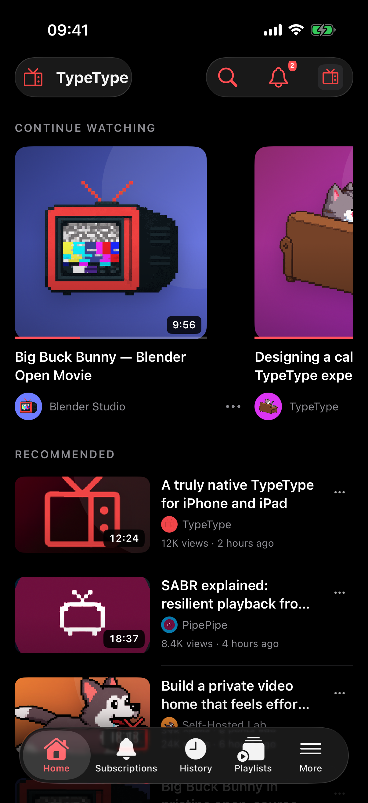

<div align="center">
  
  <h1>TypeType iOS</h1>
  <p>A native TypeType experience for iPhone and iPad.</p>
</div>

TypeType iOS brings
[TypeType](https://github.com/TypeType-Video/TypeType) to Apple devices with a
SwiftUI interface, native navigation, AVKit playback, Picture in Picture, and
an experience designed independently for iPhone and iPad. The application
connects to a TypeType-Server instance; extraction, synchronization, and
authoritative user data remain server-side.

## iPhone

| Home | Search | Playlists | Watch |
| --- | --- | --- | --- |
|  |  |  |  |

## iPad

| Home | Watch |
| --- | --- |
|  |  |

The screenshots come directly from the current application. They use its
deterministic UI-regression catalog so visual changes remain reproducible.

## Native experience

- One adaptive SwiftUI interface for iPhone and iPad
- Server setup, sign-in, registration, password reset, OIDC, and persistent sessions
- Home, multi-service search, channels, podcasts, subscriptions, history, and playlists
- Native AVKit playback, Picture in Picture, mini-player, and audio-only mode
- YouTube SABR playback through TypeType-Server with selectable H.264 quality
  and AAC audio tracks
- Queue, captions, chapters, SponsorBlock controls, comments, and related videos
- Profile, imports, downloads, notifications, content controls, settings, and administration
- Dark and light appearances with Dynamic Type and VoiceOver-friendly controls

> [!NOTE]
> The normal application uses the
> [TypeType-Server](https://github.com/TypeType-Video/TypeType-Server) API for
> authentication, discovery, playback, account data, mutations, settings,
> imports, downloads, notifications, and administration. YouTube playback
> consumes the server's SABR-backed fragmented MP4 sessions through native
> AVKit; the iOS application does not embed an extraction engine. The
> deterministic catalog is opt-in and restricted to debug simulator UI tests.

## Stack

| Area | Technology |
| --- | --- |
| Language | Swift 5.10 |
| Platform | iOS 17+ |
| Interface | SwiftUI |
| Playback | AVKit |
| Networking | URLSession |
| Persistence | Keychain and UserDefaults |
| Project generation | XcodeGen |
| Tests | XCTest and XCUITest |

## API contract

The client communicates with TypeType-Server over HTTP. Documented endpoints
follow the server
[OpenAPI specification](https://github.com/TypeType-Video/TypeType-Server/blob/dev/openapi.yaml);
integration work is also checked against the current server routes while that
published contract grows. No extraction engine or backend implementation is
embedded in the application.

## Development

Requirements:

- macOS with a current Xcode release and an iOS 17 or newer SDK
- [XcodeGen](https://github.com/yonaskolb/XcodeGen)

Generate and open the project:

```sh
xcodegen generate
open TypeTypeIOS.xcodeproj
```

Run the complete test suite:

```sh
xcodebuild \
  -project TypeTypeIOS.xcodeproj \
  -scheme TypeTypeIOS \
  -configuration Debug \
  -destination "platform=iOS Simulator,name=iPhone 17" \
  test
```

Live backend checks are isolated from the deterministic interface suite:

```sh
xcodebuild \
  -project TypeTypeIOS.xcodeproj \
  -scheme TypeTypeIOSLive \
  -destination "platform=iOS Simulator,name=iPhone 17" \
  test
```

Running either application scheme normally starts the server-connected
application. The `TypeTypeIOSLive` scheme additionally exposes the opt-in live
XCUITest suite. Deterministic interface tests enable their catalog explicitly
with debug-only `--typetype-demo-*` launch arguments.

For a physical device, select the `TypeTypeIOS` target, configure your Apple
development team and bundle identifier, then choose the connected iPhone or
iPad. Signing certificates, provisioning profiles, accounts, instance URLs,
and credentials are not stored in this repository.

## Releases

GitHub Actions validates unit tests and a Release build on pushes to `dev` and
`main`, and on pull requests. Maintainers can publish the version declared by
`MARKETING_VERSION` in `project.yml` by manually running the `iOS` workflow
from `main` with release publication enabled.

Each GitHub release contains an unsigned IPA and its SHA-256 checksum. The IPA
must be signed for the destination device by Xcode or a compatible sideloading
tool. Apple signing certificates, provisioning profiles, and account
credentials are never handled by the public build.

## Project structure

| Path | Contents |
| --- | --- |
| `TypeTypeIOS/App` | Application entry point and root composition |
| `TypeTypeIOS/Core` | Networking, authentication, storage, logging, and configuration |
| `TypeTypeIOS/DesignSystem` | Theme tokens and reusable native components |
| `TypeTypeIOS/Features` | Feature-first screens, models, services, and state |
| `TypeTypeIOS/MockData` | Debug-only deterministic UI-regression catalog |
| `TypeTypeIOS/Resources` | Asset catalogs and bundled playback fixture |
| `TypeTypeIOSTests` | Unit and integration tests |
| `TypeTypeIOSUITests` | Deterministic iPhone and iPad interface regression tests |
| `TypeTypeIOSLiveUITests` | Opt-in end-to-end checks against TypeType-Server |

## TypeType ecosystem

| Repository | Responsibility |
| --- | --- |
| [TypeType](https://github.com/TypeType-Video/TypeType) | Stack, installation, releases, coordination, and issues |
| [TypeType-Frontend](https://github.com/TypeType-Video/TypeType-Frontend) | React browser client |
| [TypeType-Server](https://github.com/TypeType-Video/TypeType-Server) | Kotlin API, extraction, and private user data |
| [TypeType-Player](https://github.com/TypeType-Video/TypeType-Player) | Browser MSE and SABR playback package |
| [TypeType-Android](https://github.com/TypeType-Video/TypeType-Android) | Native Android client |
| [Docs-TypeType](https://github.com/TypeType-Video/Docs-TypeType) | User and self-hosting documentation |

Development changes target `dev`. `main` represents the stable release line.
Bug reports and feature requests belong in the
[central issue tracker](https://github.com/TypeType-Video/TypeType/issues).

## Media and trademarks

The bundled demonstration movie is
[Big Buck Bunny](https://peach.blender.org/), © 2008 Blender Foundation,
licensed under [CC BY 3.0](https://creativecommons.org/licenses/by/3.0/). The
copy in this repository is encoded for offline application playback.

Third-party names, logos, and trademarks remain the property of their
respective owners. Their inclusion in the interface does not place them under
the Mozilla Public License.

## License

TypeType iOS source code is licensed under the
[Mozilla Public License 2.0](LICENSE).

Copyright © 2026 Priveetee and TypeType contributors.

The MPL-2.0 does not grant rights to third-party media, names, logos, or
trademarks. Those remain subject to their respective licenses and rights.
