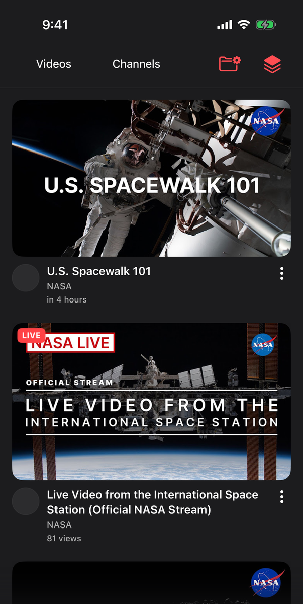
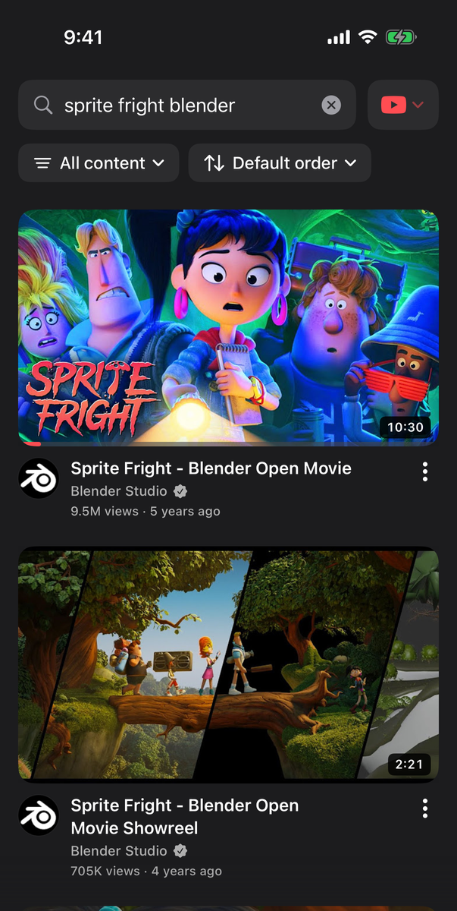
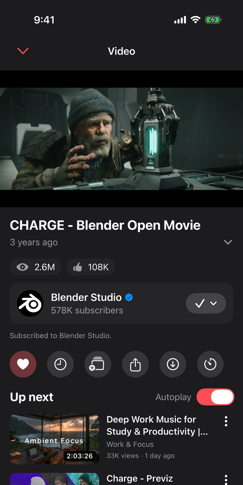
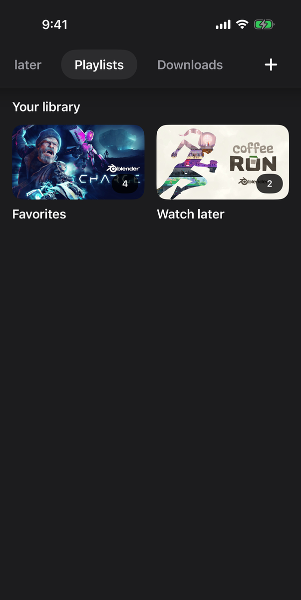
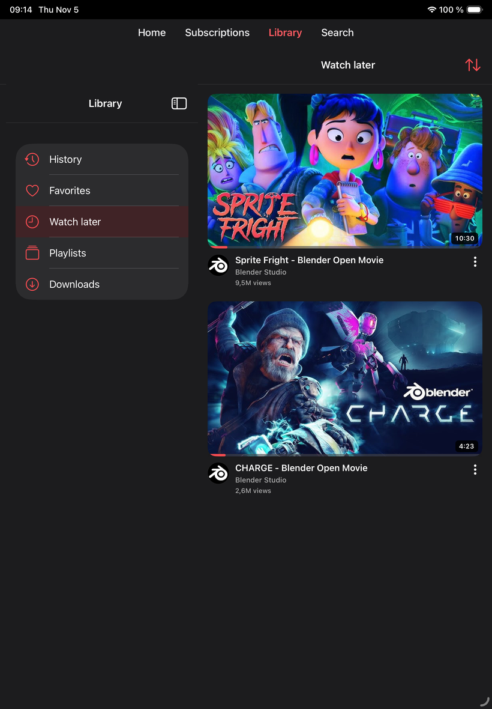
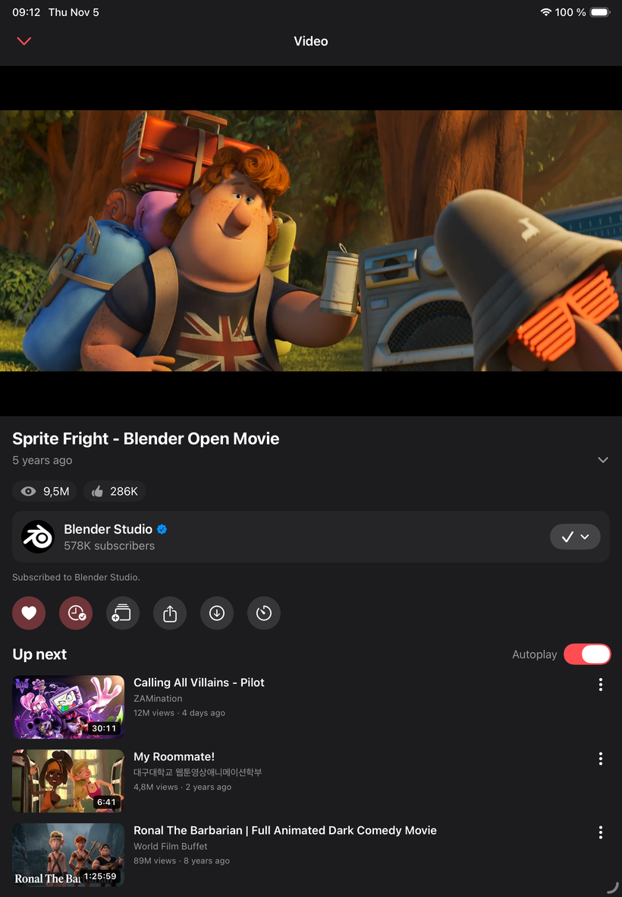

<!-- markdownlint-disable MD033 MD041 -->

<div align="center">
  
  <h1>TypeType iOS</h1>
  <p>Native iPhone and iPad client for TypeType.</p>
</div>

You want to know the current position of TypeType about AI ? Go check [this](https://github.com/TypeType-Video/TypeType/blob/dev/AI_TRANSPARENCY.md).

<div align="center">

[](LICENSE)
[](project.yml)
[](https://github.com/TypeType-Video/TypeType)

[User guide](https://typetype-video.github.io/Docs-TypeType/guide/) · [Download](https://github.com/TypeType-Video/TypeType-IOS/releases/latest) · [Report a problem](https://github.com/TypeType-Video/TypeType-IOS/issues)

</div>

TypeType iOS is the native client for
[TypeType](https://github.com/TypeType-Video/TypeType), a self-hosted video
platform. It runs on iPhone and iPad with iOS 17 or newer and plays YouTube,
BiliBili and NicoNico without a WebView.

The app uses the TypeType Server selected during setup for extraction, playback
sessions, recommendations, synchronization, and downloads.

## Screenshots

| Subscriptions | Search | Watch | Library |
| --- | --- | --- | --- |
|  |  |  |  |

| iPad library | iPad watch |
| --- | --- |
|  |  |

## Features

- Browse and search videos, channels, playlists, and subscriptions.
- Get recommendations from your instance, and mark the ones that are not for
  you.
- Start videos quickly: the videos in view are prepared when you stop
  scrolling.
- Resume videos, manage history, favorites, Watch Later, playlists, and
  notifications.
- Use the Library with a sidebar on iPad and on large iPhones in landscape.
- Play in the background, in Picture in Picture, or with the mini-player.
- Swipe for volume, brightness and seeking, double tap to skip, hold for 2x,
  like the Android app.
- Use chapters, SponsorBlock, DeArrow, comments, related videos, the queue,
  autoplay, and the sleep timer.
- Download videos, audio or thumbnails and watch them offline, with saving that
  picks up again after leaving the app or losing the network.
- Switch between several accounts, themes, and English or French.

## Install

1. Download the IPA from the
   [latest Release](https://github.com/TypeType-Video/TypeType-IOS/releases/latest).
2. Verify it with the matching SHA-256 file if desired.
3. Sign and install it with a sideloading tool such as
   [SideStore](https://sidestore.io) or [AltStore](https://altstore.io), or with
   Xcode.
4. On iOS 16 and newer, turn on **Settings > Privacy & Security > Developer
   Mode** the first time.
5. Enter your TypeType instance address and sign in, use OIDC, or continue as a
   guest when supported.

> [!NOTE]
> TypeType iOS is a client for
> [TypeType-Server](https://github.com/TypeType-Video/TypeType-Server). You need
> access to a compatible TypeType instance. If you want to host one, start with
> the [self-hosting guide](https://typetype-video.github.io/Docs-TypeType/self-hosting/introduction).

## Build from source

You need Xcode and [XcodeGen](https://github.com/yonaskolb/XcodeGen).

```sh
xcodegen generate
open TypeTypeIOS.xcodeproj
```

Run the unit tests before opening a pull request against `dev`:

```sh
xcodebuild -project TypeTypeIOS.xcodeproj -scheme TypeTypeIOSUnit \
  -destination "platform=iOS Simulator,name=iPhone 17" test
```

GitHub Actions runs the same unit tests and an unsigned build on every push and
pull request. A version tag builds the unsigned IPA and its SHA-256 and attaches
them to the release. The IPA is never signed in CI: sign it when you sideload
it.

## Help and feedback

- Read the [TypeType user guide](https://typetype-video.github.io/Docs-TypeType/guide/).
- Check the [latest iOS Releases](https://github.com/TypeType-Video/TypeType-IOS/releases).
- Report bugs and request features in the
  [TypeType iOS issue tracker](https://github.com/TypeType-Video/TypeType-IOS/issues).

When reporting a problem, include the iOS version, app version, TypeType Server
version, the action that failed, and the request ID from **Settings >
Diagnostics** when available.

## License

TypeType iOS is licensed under the [Mozilla Public License 2.0](LICENSE).

Copyright © 2026 Priveetee and TypeType contributors.

The screenshots show public YouTube videos, taken with a test account on a test
instance.
