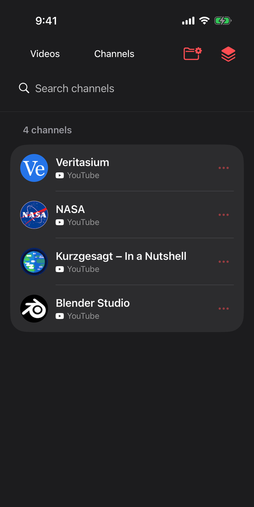
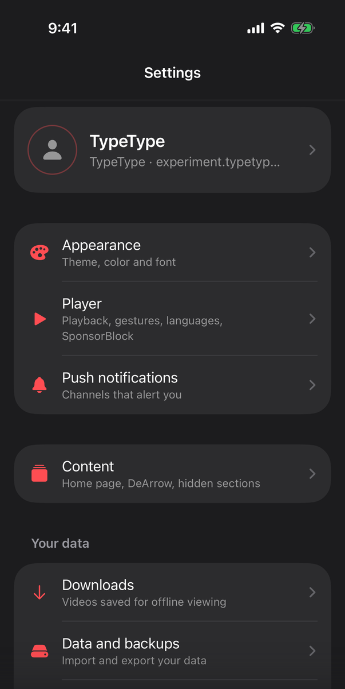
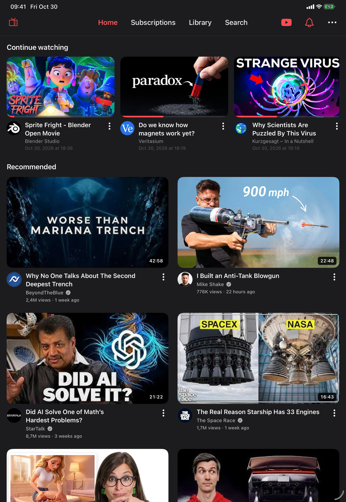

<!-- markdownlint-disable MD033 MD041 -->

<div align="center">
  
  <h1>TypeType iOS</h1>
  <p>The native iPhone and iPad client for TypeType.</p>
</div>

<div align="center">

[](LICENSE)
[](project.yml)
[](project.yml)

</div>

A SwiftUI client for a self-hosted
[TypeType](https://github.com/TypeType-Video/TypeType) instance. It talks only
to [TypeType-Server](https://github.com/TypeType-Video/TypeType-Server):
extraction, YouTube sessions, SABR, recommendations, downloads and your data
stay on the server. The app turns what the server returns into native playback.
No WebView.

TypeType's position on AI is in
[AI_TRANSPARENCY.md](https://github.com/TypeType-Video/TypeType/blob/dev/AI_TRANSPARENCY.md).

| Subscriptions | Search | Watch | Library |
| --- | --- | --- | --- |
|  |  |  |  |

| Channels | Settings |
| --- | --- |
|  |  |

| iPad home | iPad watch |
| --- | --- |
|  |  |

## What it does

- YouTube, BiliBili and NicoNico: home, search, channels, subscriptions,
  history, playlists, favorites, Watch Later.
- Player gestures from the Android app: swipe for volume, brightness and
  seeking with a storyboard preview, double tap to skip, hold for 2x.
- Queue and autoplay, chapters, captions, SponsorBlock, DeArrow, comments,
  danmaku on NicoNico, sleep timer, Picture in Picture, background audio.
- Audio, video and image downloads with offline playback.
- Local accounts, OIDC, guest access, several accounts per instance, YouTube
  sign-in through the instance.
- Six themes, English and French, Dynamic Type, VoiceOver.

## Playback

| Source | How it plays |
| --- | --- |
| YouTube | In-house player: SABR sessions, fragmented MP4 drawn through `AVSampleBufferDisplayLayer` |
| BiliBili | In-house player: byte-range loading with SIDX indexes |
| Live streams | AVPlayer with AVKit controls |
| NicoNico | AVKit, with danmaku drawn on top |
| Downloads | AVKit, from the local file |

The in-house player draws its own controls, full screen included, and keeps
Picture in Picture through the sample buffer layer.

## Build

You need macOS with a current Xcode and
[XcodeGen](https://github.com/yonaskolb/XcodeGen).

```sh
xcodegen generate
open TypeTypeIOS.xcodeproj
```

Tests:

```sh
# unit tests
xcodebuild -project TypeTypeIOS.xcodeproj -scheme TypeTypeIOSUnit \
  -destination "platform=iOS Simulator,name=iPhone 17" test

# unit and deterministic UI tests
xcodebuild -project TypeTypeIOS.xcodeproj -scheme TypeTypeIOS \
  -destination "platform=iOS Simulator,name=iPhone 17" test
```

`TypeTypeIOSLive` runs end-to-end UI tests against a real server. The
deterministic UI tests use a debug-only demo catalogue, enabled with
`--typetype-demo-*` launch arguments.

To run on a device, set your team and bundle identifier on the `TypeTypeIOS`
target. No signing material, account or instance address is stored here.

Continuous integration is paused (`.github/workflows/ios.yml.disabled`): run
the tests before opening a pull request.

## Releases

GitHub releases ship an unsigned IPA and its SHA-256 checksum, built from
`main` at the `MARKETING_VERSION` in `project.yml`. Sign it for your device with
Xcode or a sideloading tool.

## Layout

| Path | Contents |
| --- | --- |
| `TypeTypeIOS/App` | Entry point, root coordinator, dependencies |
| `TypeTypeIOS/Core` | Networking, storage, Keychain, logging |
| `TypeTypeIOS/DesignSystem` | Theme palette and shared components |
| `TypeTypeIOS/Features` | One folder per feature; `Watch` holds the player |
| `TypeTypeIOS/MockData` | Debug-only demo catalogue for UI tests |
| `TypeTypeIOSTests` | Unit tests |
| `TypeTypeIOSUITests` | Deterministic UI tests |
| `TypeTypeIOSLiveUITests` | End-to-end tests against a server |

Work goes to `dev`; `main` is the stable line. Bugs and requests go to the
[central issue tracker](https://github.com/TypeType-Video/TypeType/issues).

## Other TypeType repositories

[TypeType](https://github.com/TypeType-Video/TypeType) (stack and issues) ·
[Server](https://github.com/TypeType-Video/TypeType-Server) ·
[Frontend](https://github.com/TypeType-Video/TypeType-Frontend) ·
[Player](https://github.com/TypeType-Video/TypeType-Player) ·
[Android](https://github.com/TypeType-Video/TypeType-Android) ·
[Docs](https://github.com/TypeType-Video/Docs-TypeType)

## License

[Mozilla Public License 2.0](LICENSE). Copyright © 2026 Priveetee and TypeType
contributors.

Screenshots show public YouTube videos, taken with a test account on a test
instance. The demo catalogue streams
[Big Buck Bunny](https://peach.blender.org/) (© 2008 Blender Foundation,
[CC BY 3.0](https://creativecommons.org/licenses/by/3.0/)) from a public
mirror. Third-party names and logos belong to their owners and are not covered
by the MPL.
